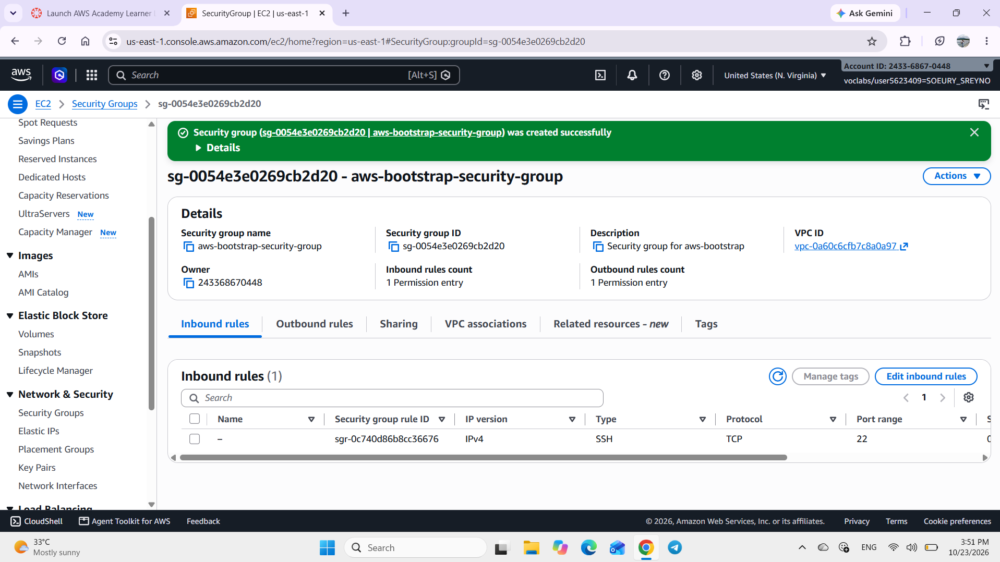
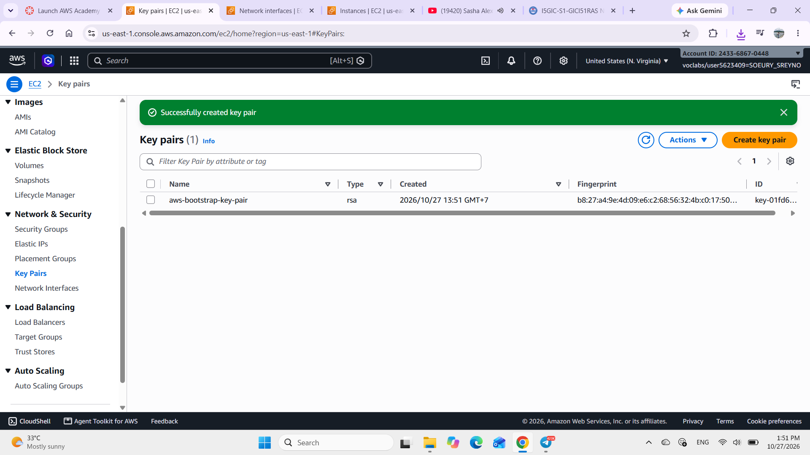
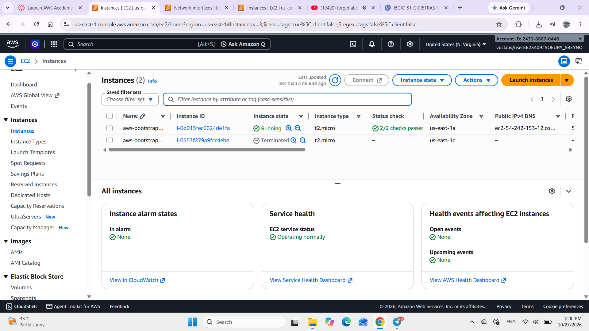
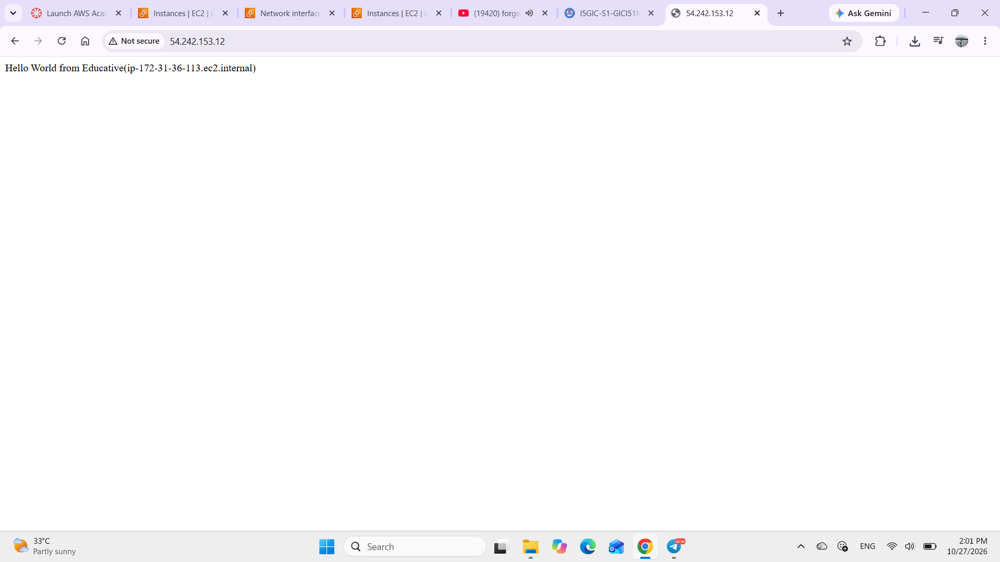
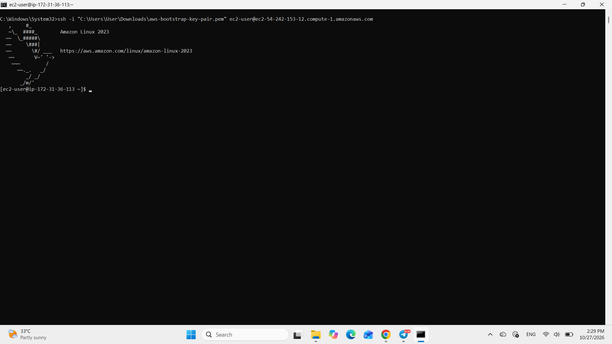
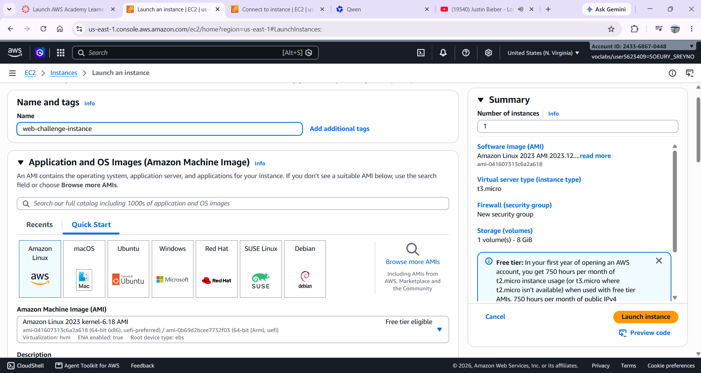
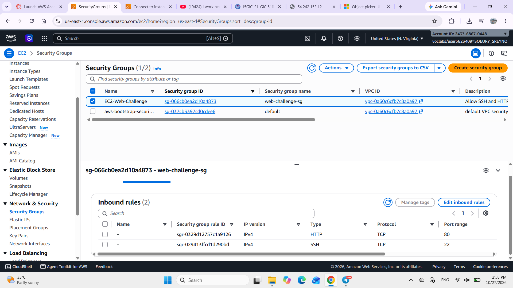
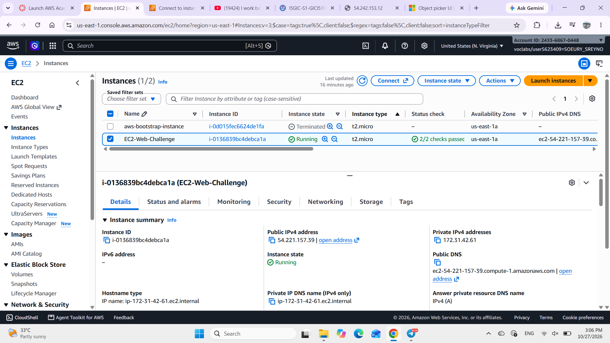
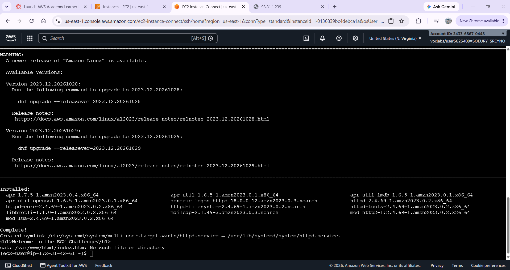
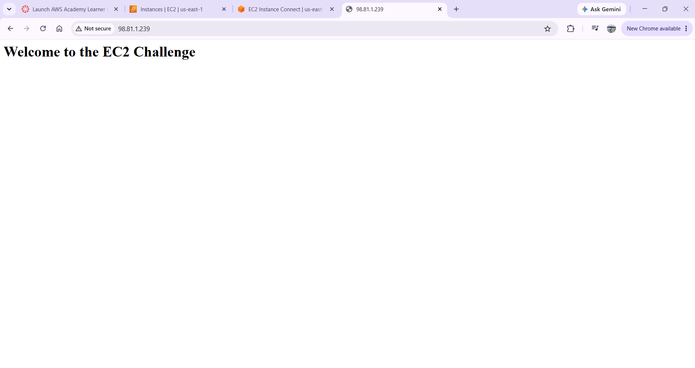

# Cloud Lab 1 Submission — Amazon EC2

Copy this template to `cc-lab-YOUR_ID/lab1/README.md` in your own repository. Follow [the instructions](lab1-instruction.md). Put your screenshots in `lab1/images/` with the file names below.

- **Student name: Soeury Sreyno**
- **Student ID: e20220908**
- **Learner Lab user name: voclabs/user5623409=SOEURY_SREYNO**
- **Date completed: 25/10/2026**

---

## Part 1.1 — An Amazon EC2 Walkthrough

### Security group



### Key pair



### Instance details



### Browser test



### SSH connection



Did you connect with your own SSH client or with EC2 Instance Connect?

---

## Part 1.2 — EC2 Web Solution (Challenge)

### Launch configuration



### Security group



### Running instance



### Commands on the instance



Paste the commands you ran to install the web server and create `index.html`:

```bash

```

### Browser test



---

## Questions

1. Your security group has an SSH rule and an HTTP rule. What does each one let you do? What would stop working if you deleted the HTTP rule?
   Answer: 
   - SSH rule (Port 22): Allows adminastrative command-line access into the EC2 instance remontly via as SSH Instance Connect.
   - HTTP rule (Port 80): Allows web broswers to access and view hosted website across the public internet using standard unencryted web traffic (http://).
   - Web broswers will no longer ba able to load your web page (http://<Public-IP> will hang and eventually time out). However, your SSH terminal access remains intsct because SSH used port 22, not port 80.
  
2. In Part 1.1 you never logged in to install the web server. What installed it, and when did it run?
    Answer: An automated shell script provided in the EC2 User Data field (located under Advanced details during launch). It executed automatically with root privileges during the initial first boot of the instance via cloud-init.

3. Why does the web page open with `http://` but not with `https://`?
    Answer: 
    - Port / Protocol difference: http:// uses port 80 (which is open in your security group and configures in Apache), whereas https:// uses port 443 (encryted SSL/TLS traffic). 
    - Missing SSL Certificate: A webb server needs as SSL/TLS certificates installed and an oopen port 443 invound rule to serve HTTPS traffic. Because port 443 is not open in the security group and Apache has no SSL certificate configured, HTTPS requests fail to establish a connection.
  
4. Part 1.2 asked for a 10 GiB root volume. Where in the launch settings did you set it, and how can you check the size on the running instance?
    Answer: The lunch settings that I set is in the Configure storage section of the EC2 Luanch wizard, by changing the default root volume size from 8 GiB to 10 GiB.
    How to check it on the running instance: Go to EC2 -> Instances -> select the instance -> click the Storage tab below, which lists the attached root block device along with its size (10 GiB).


## Problems and how I solved them (optional)

## AI note (optional)

One suggestion an AI tool gave you and how you checked it.

## Clean up

- [ ] Part 1.1: instance terminated, key pair and security group deleted.
- [ ] Part 1.2: instance terminated, security group (and key pair, if any) deleted.