# Cloud Lab 2 Submission — Load Balancer and Auto Scaling

Copy this template to `cc-lab-YOUR_ID/lab2/README.md` in your own repository. Follow [the instructions](lab2-instruction.md). Put your screenshots in `lab2/images/` with the file names below.

- **Student name: Soeury Sreyno**
- **Student ID: e20220908**
- **Learner Lab user name: voclabs/user5623409=SOEURY_SREYNO**
- **Date completed: 30/10/2026**

---

## Security groups

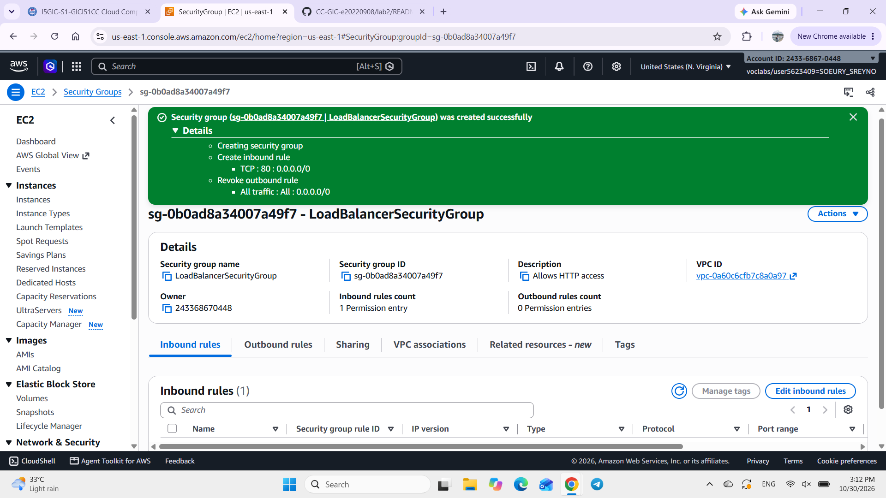

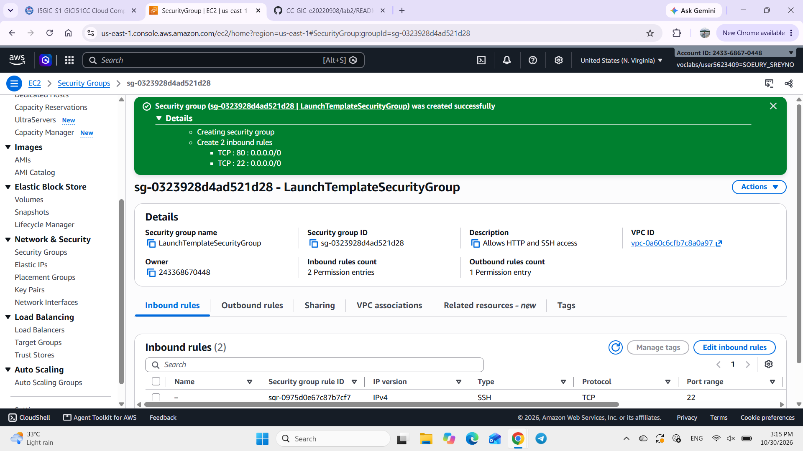

## Target group

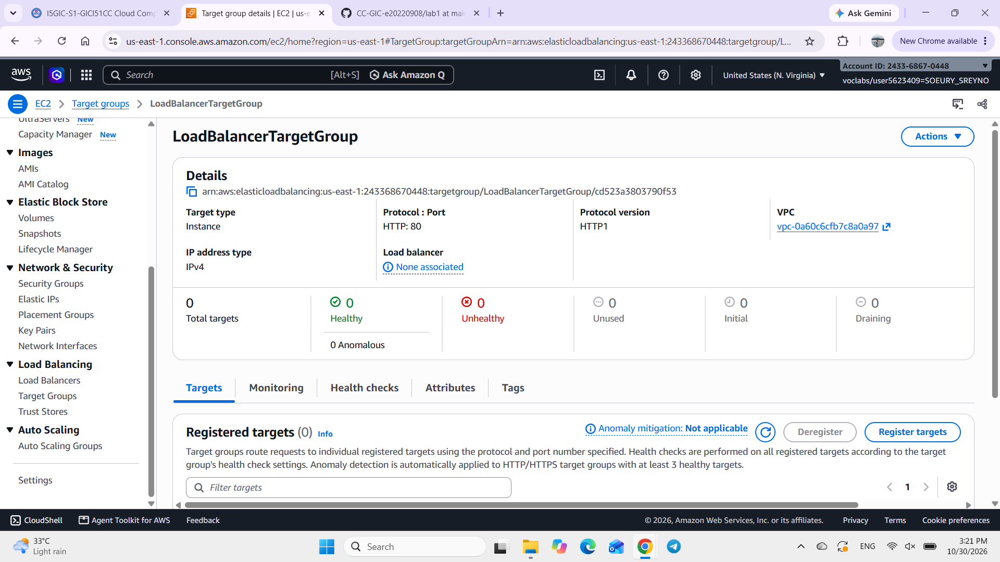

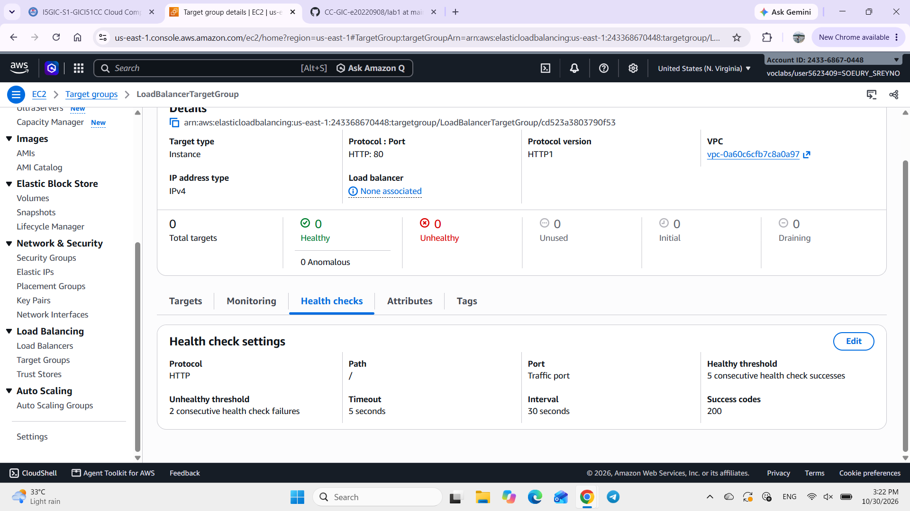

## Application Load Balancer

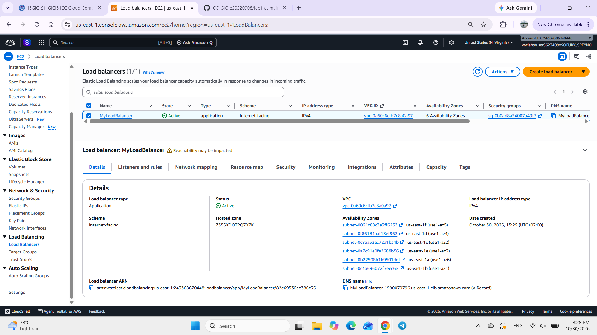

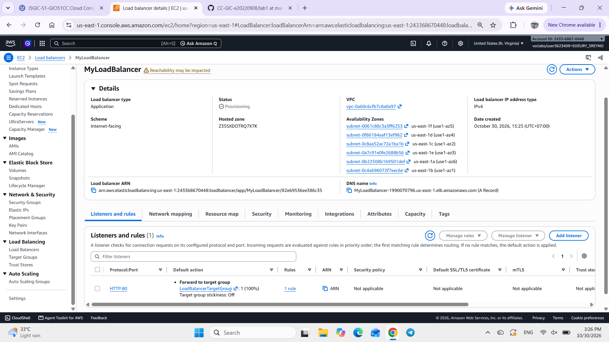

## Launch template

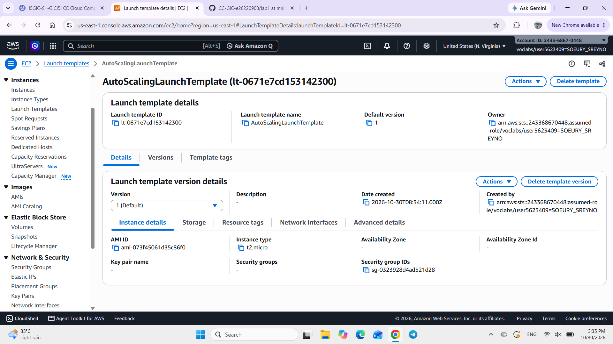

## Auto Scaling group

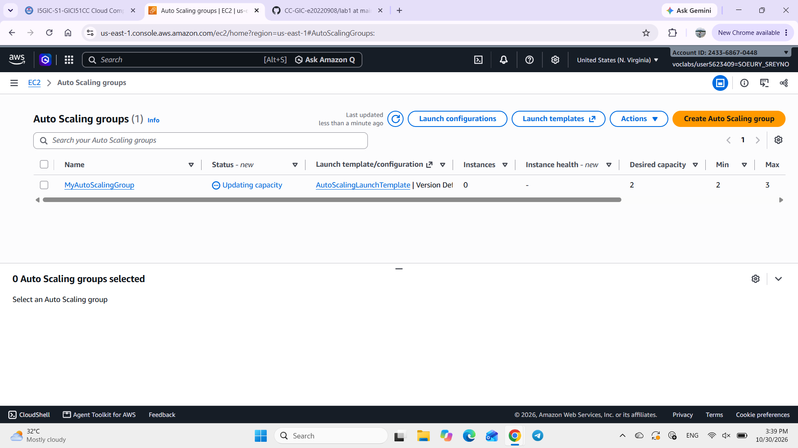

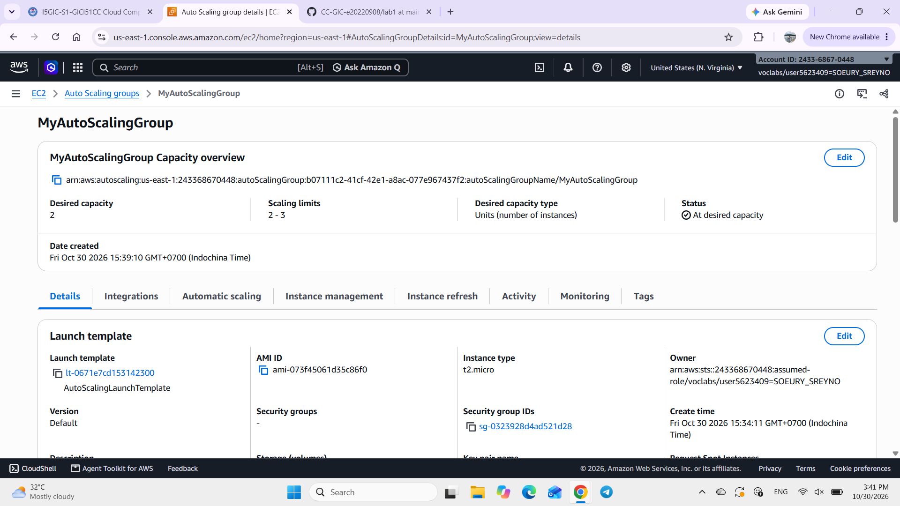

## Load balancing test

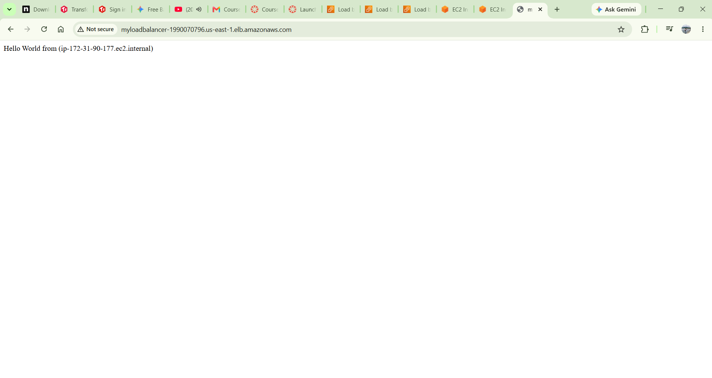

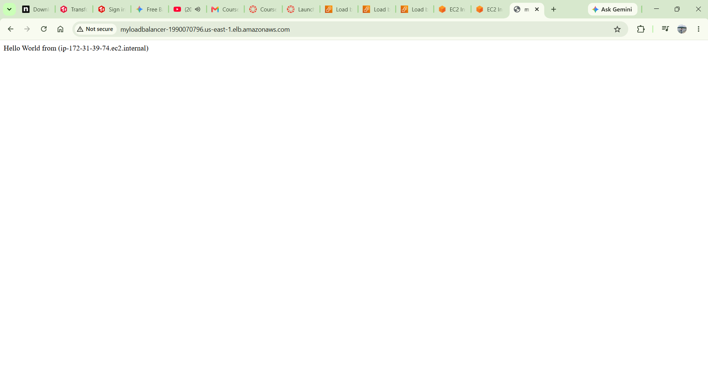

## Simulated application failure

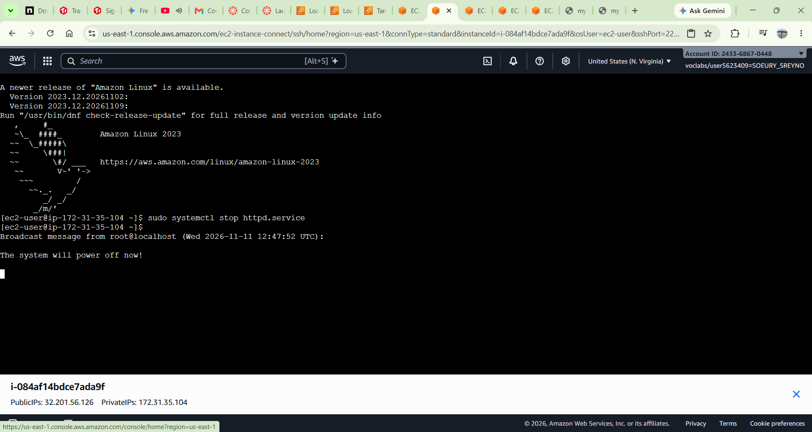

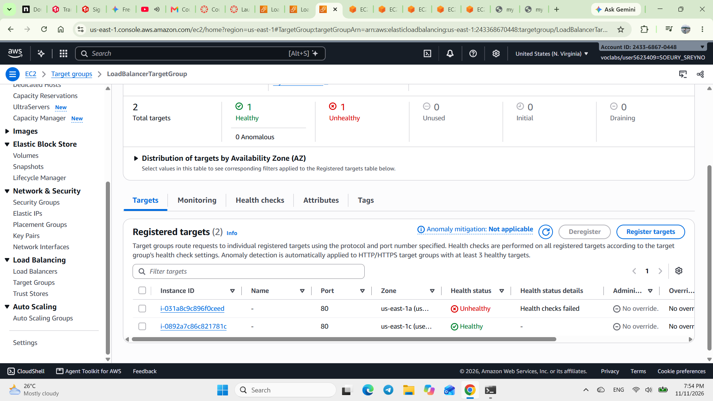

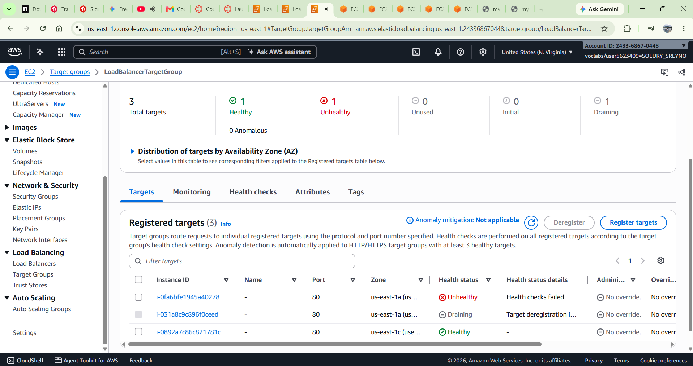

About how many minutes passed between stopping `httpd` and the new instance becoming healthy?

---

## Questions

1. Why does the page show a different host name when you refresh it?
   
    The Application Load Balancer (ALB) distributes incoming traffic across your multiple backend EC2 instances using a round-robin (or similar) routing algorithm. When you refresh your browser, a new request is sent to the load balancer, which may forward it to a different healthy instance in the target group, displaying that specific instance's internal hostname/IP address.
  

2. After you stopped `httpd`, the instance was still *running* in EC2, but the target group marked it *unhealthy*. What did the health check test, and why did the instance fail it?

    The health check sent an HTTP GET request (via port 80 to path /) from the load balancer to the instance to verify that the web application was actively responding.
    It fails because you stopped the Apache web server (httpd), port 80 was no longer listening, causing the connection to time out or be refused.

3. Who replaced the failed instance: the load balancer, the target group, or the Auto Scaling group? Explain the role of each one.

    * The Auto Scaling Group (ASG): It replaced the instance. The ASG continuously monitors instance health signals from the target group; when an instance becomes unhealthy, the ASG terminates it and provisions a brand-new replacement instance to maintain the desired capacity.
    * The Target Group: It detects the health failure and reports the status as unhealthy to the ASG.
    * The Load Balancer: It routes client traffic and performs the active health check probes, but it does not manage instance lifecycles or launch replacements.

4. With desired 2, minimum 2 and maximum 3, how many instances run normally? In what situation could there be 3?

    2 instances run normally, matching your "desired" and "minimum" capacity settings.There could be 3 instances if traffic spikes and CPU/utilization metrics trigger a scaling policy, or temporarily during an instance replacement (when a new instance is launched and warming up before the unhealthy/old instance is fully terminated).

5. The instances' security group allows HTTP from anywhere. How could you change it so that the instances accept HTTP **only** from the load balancer?
   
   Instead of setting the Inbound Rule source to 0.0.0.0/0 (Anywhere), you can edit the security group rule to set the Source to the Security Group ID of the Load Balancer itself. This ensures that only traffic originating from your ALB is allowed to reach port 80 on your EC2 instances.

## Problems and how I solved them (optional)

## AI note (optional)

One suggestion an AI tool gave you and how you checked it.

## Clean up

- [x] `MyAutoScalingGroup` deleted and its instances terminated.
- [x] `AutoScalingLaunchTemplate` deleted.
- [x] `MyLoadBalancer` and `LoadBalancerTargetGroup` deleted.
- [x] Both security groups deleted.