# Cloud Lab 4 Submission — Amazon VPC

Copy this template to `cc-lab-YOUR_ID/lab4/README.md` in your own repository. Follow [the instructions](lab4-instruction.md). Put your screenshots in `lab4/images/` with the file names below.

- **Student name: SOEURY SREYNO**
- **Student ID: e20220908**
- **Learner Lab user name: voclabs/user5623409=SOEURY_SREYNO**
- **Date completed: 11/11/2026**

---

## VPC and internet gateway

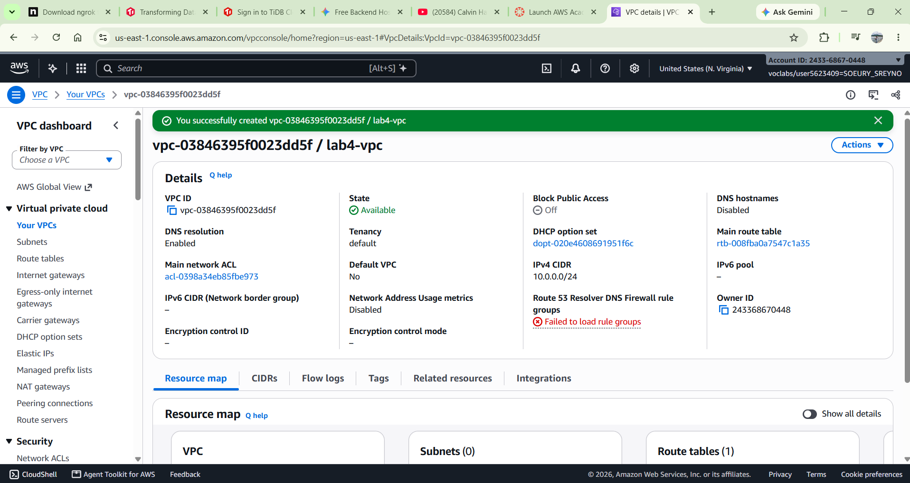

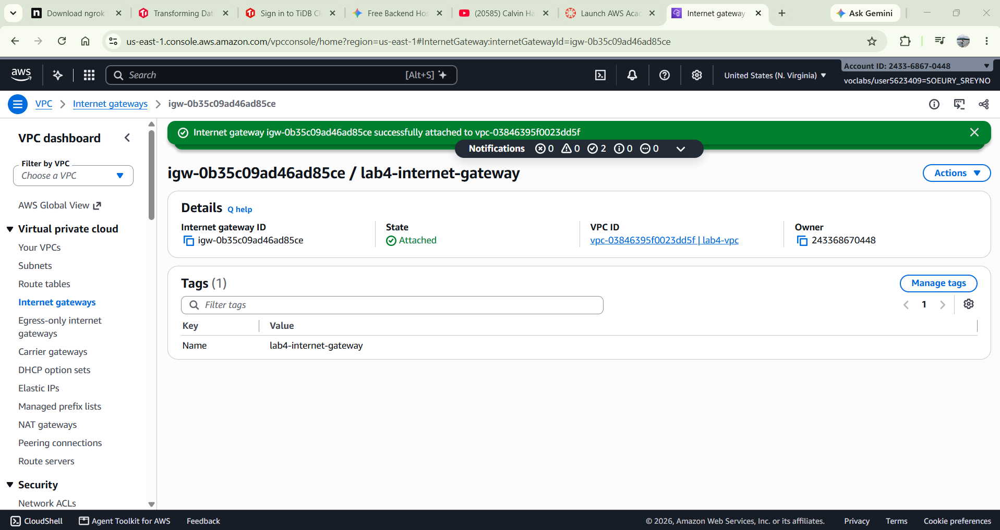

## Public subnet

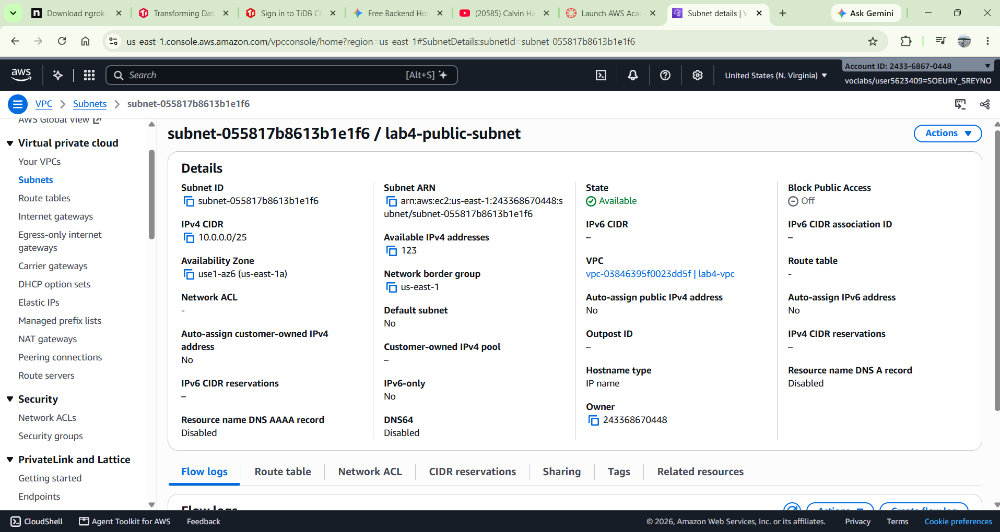

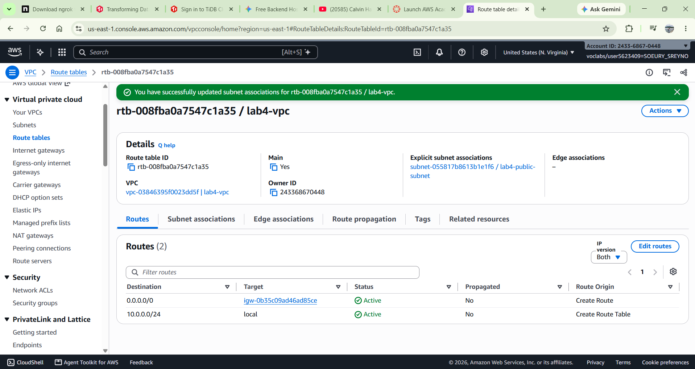

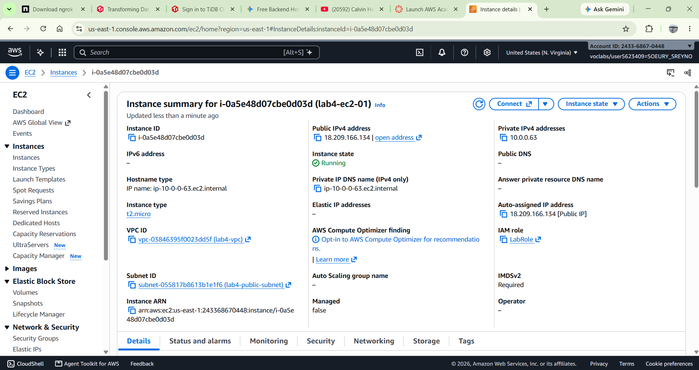

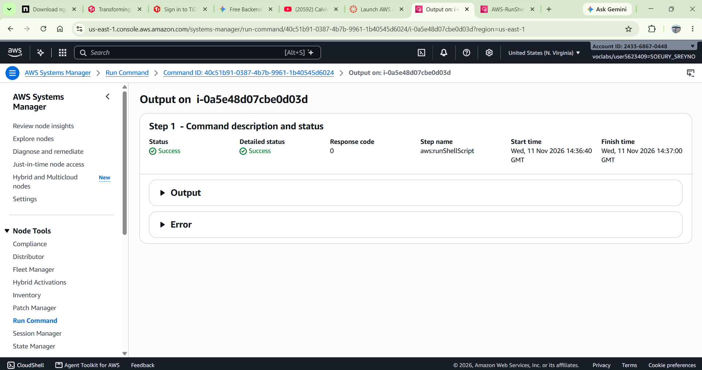

## Private subnet

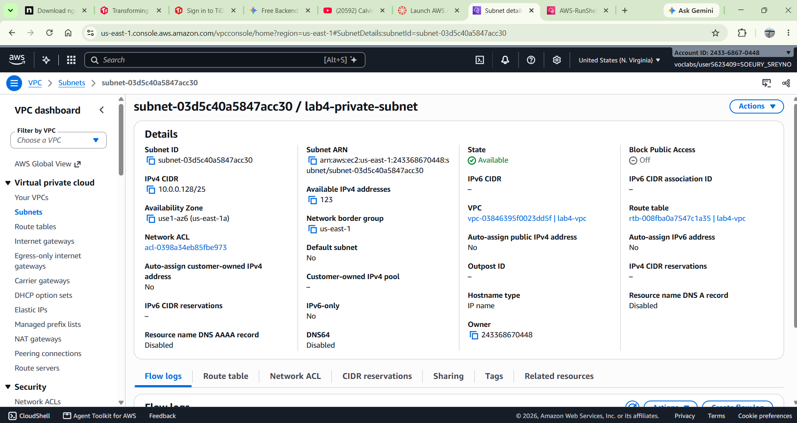

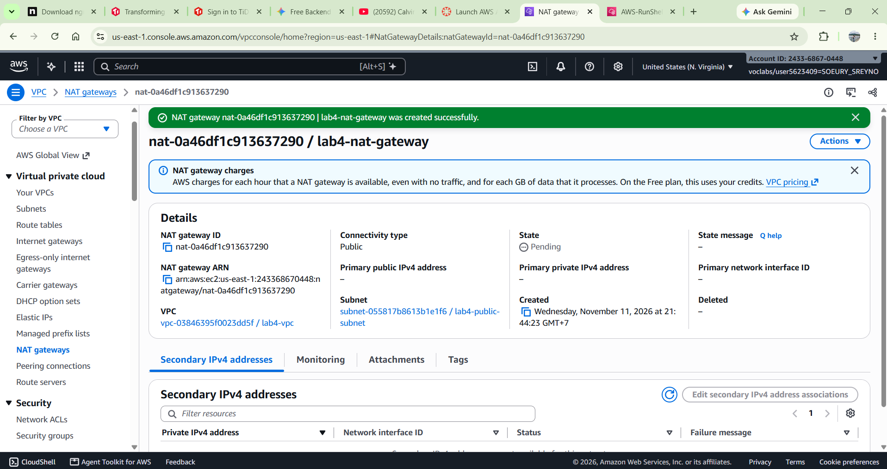

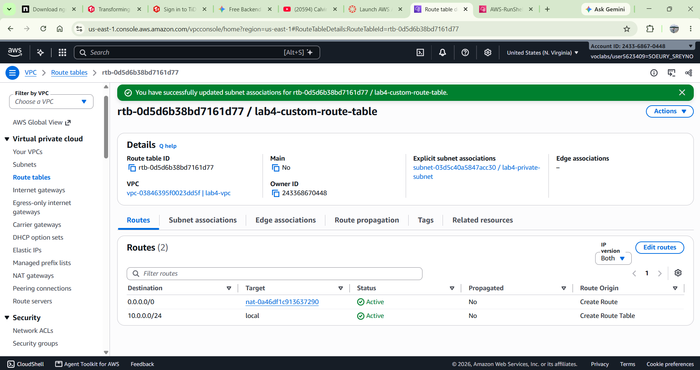

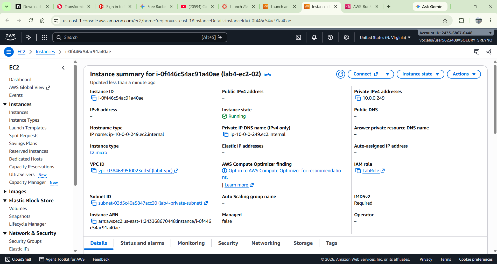

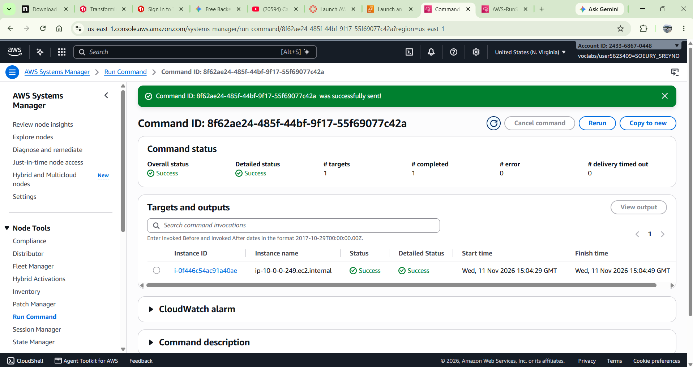

---

## Questions

1. The VPC is `10.0.0.0/24` and the subnets are `10.0.0.0/25` and `10.0.0.128/25`. How many IP addresses does each block contain, and why do the two subnets not overlap?
2. Both subnets are in the same VPC. What exactly makes `lab4-public-subnet` public and `lab4-private-subnet` private?
3. Why is the NAT gateway placed in the **public** subnet and not in the private one?
4. `lab4-ec2-02` has no public IP address. Can someone on the internet open a connection to it? Can it download updates? Explain both answers.
5. You tested internet access with Systems Manager instead of SSH. Why did the instances need `LabInstanceProfile` for this?
   
## Answers

1. Each /25 subnet contains 128 IP addresses. The two subnets do not overlap because they use separate ranges of IP addresses. The first subnet ends at 10.0.0.127, and the second starts at 10.0.0.128 .
2. What makes a subnet public or private is its route table configuration, not simply its IP address or its VPC.
   - Public subnet (lab4-public-subnet): Its route table has a route to an Internet Gateway (IGW), usually 0.0.0.0/0 → Internet Gateway. This allows resources with public IP addresses to communicate directly with the internet.
   - Private subnet (lab4-private-subnet): Its route table does not have a direct route to the Internet Gateway. Instead, it usually has a default route 0.0.0.0/0 → NAT Gateway.

    Therefore, the public subnet can provide direct internet connectivity, while the private subnet uses the NAT Gateway to access the internet indirectly.

3. The NAT Gateway is placed in the public subnet because it needs access to the Internet Gateway to forward internet traffic. The NAT Gateway allows instances in private subnets to access the internet without exposing their private IP addresses. If the NAT Gateway were placed in the private subnet, it would not have the required direct route to the Internet Gateway for this design.
4. First: Can someone on the internet open a connection to it? No, not directly. lab4-ec2-02 is in the private subnet and does not have a public IP address. Therefore, someone on the internet cannot directly connect to it using its private IP address. This helps protect the instance from direct inbound internet connections.

Second: Can it download updates? Yes, it can download updates if the private subnet's route table sends internet-bound traffic to the NAT Gateway. 

5. The instances needed LabInstanceProfile because AWS Systems Manager (SSM) requires permission to communicate with and manage EC2 instances.

LabInstanceProfile is an IAM instance profile that provides an IAM role to the EC2 instances. This role includes permissions, commonly through the AmazonSSMManagedInstanceCore policy, allowing the SSM Agent running on the instances to communicate with AWS Systems Manager.

## Problems and how I solved them (optional)

## AI note (optional)

One suggestion an AI tool gave you and how you checked it.

One suggestion an AI tool gave me was to place the NAT Gateway in the public subnet so that instances in the private subnet could access the internet. I checked this suggestion by reviewing the AWS VPC route table configuration and AWS documentation. I confirmed that the NAT Gateway needs a route to the Internet Gateway to allow private instances to access the internet.

## Clean up

- [x] Instances terminated.
- [x] NAT gateway deleted and its Elastic IP released.
- [x] Internet gateway detached and deleted.
- [x] `lab4-vpc` deleted.
